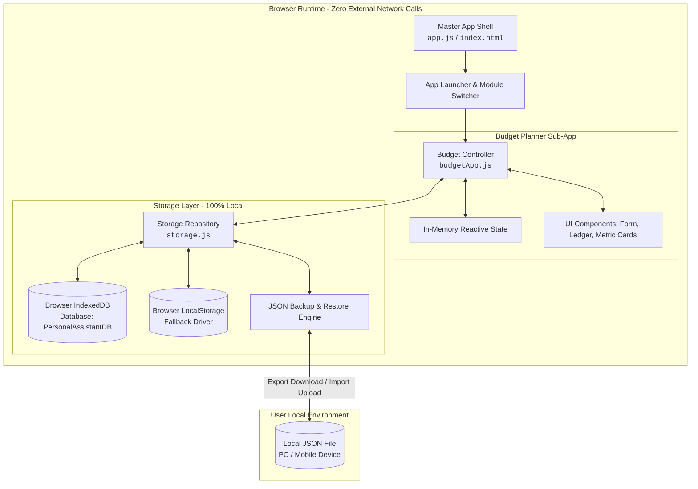

# System Architecture & Detailed Design Specification

**Document ID**: `SPEC-001-budget`  
**Parent Requirements**: `REQ-SPEC-001` (`REQ-001` through `REQ-008`)  
**Author**: System Architect  
**Approved By**: Tech Lead (Gate 1 Clearance)  
**Status**: 🟢 APPROVED  

---

## 1. System Topology & Component Architecture



---

## 2. Directory & Module Breakdown

```
PersonalAssistant/
├── index.html                  # Master Application Shell & Sub-App Container
├── css/
│   └── style.css               # Unified Design System, Tokens, Glassmorphism & Media Queries
├── js/
│   ├── app.js                  # Master Application Initialization & App Launcher
│   ├── budgetApp.js            # Budget & Expense Planner Controller & State Logic
│   └── storage.js              # Local-first IndexedDB / LocalStorage Repository & Backup Driver
├── docs/                       # V-Cycle Specifications, Plans & Audits
└── tests/                      # Automated Unit, Integration & E2E Suites
```

---

## 3. Data Schemas

### 3.1 Transaction Entity
```typescript
interface Transaction {
  id: string;               // UUID or timestamp-random string (e.g., "tx_17192348234")
  type: 'income' | 'expense';
  amount: number;           // Standard positive float, 2 decimal places
  category: string;         // e.g., "Salary", "Food", "Rent", "Utilities", "Entertainment", "Health"
  date: string;             // ISO date string "YYYY-MM-DD"
  description: string;      // Free-form user note
  createdAt: number;        // Epoch timestamp
}
```

### 3.2 Backup Envelope Entity (Cross-Device Portability)
```typescript
interface BudgetBackupEnvelope {
  app: 'PersonalAssistant-BudgetPlanner';
  version: '1.0.0';
  exportedAt: string;       // ISO 8601 Timestamp
  schemaVersion: 1;
  recordCount: number;
  data: {
    transactions: Transaction[];
    currency: string;       // Default "$"
  };
}
```

---

## 4. State Management & Mathematical Logic
- **Total Income**: $\sum \text{amount where type} = \text{'income'}$
- **Total Expense**: $\sum \text{amount where type} = \text{'expense'}$
- **Net Balance**: $\text{Total Income} - \text{Total Expense}$
- **Formatting**: Currency localization using standard formatting (`$X,XXX.XX`).

---

## 5. Privacy & Zero-Knowledge Architecture
1. **Network Isolation**: No external fetch/AJAX endpoints for user data.
2. **Local Repository**: Uses IndexedDB database `PersonalAssistantDB` with object store `transactions`.
3. **Graceful Fallback**: If IndexedDB is blocked or disabled in private browsing, automatically falls back to `window.localStorage`.
4. **Data Portability**: JSON export creates an in-memory `Blob` and triggers a native file download. JSON import reads via `FileReader`, validates the schema, and commits to the database.

---

## 6. Responsive UI & Mobile Breakpoints
- **Desktop (>= 1024px)**: Dual-column layout (Left: Input Form & Summary Cards; Right: Search, Filter, and Transaction Ledger).
- **Tablet & Mobile (< 1024px)**: Single-column ergonomic flow with sticky summary header, collapsible filters, and large touch-friendly action buttons.

---

## 7. Gate 1 Sign-Off
- [x] All functional requirements (REQ-001 to REQ-008) addressed in architecture.
- [x] Strict local-only privacy constraint verified by design.
- **Gate 1 Status**: **PASSED** &rarr; Ready for Lead Developer (`TASK-003`).
