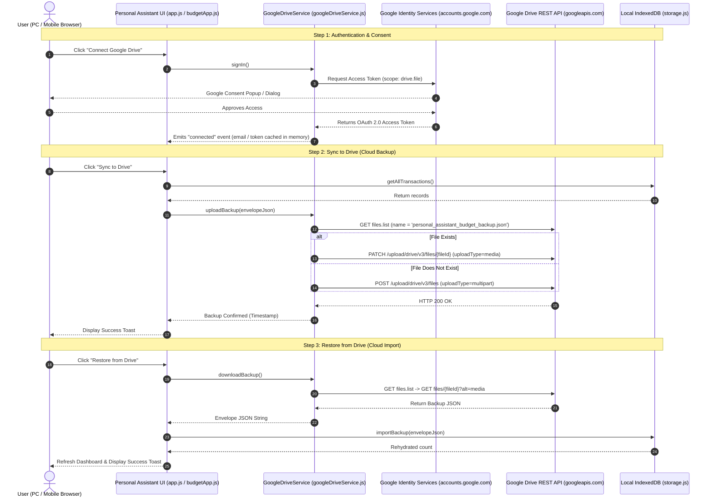

# System Architecture Specification: Google Identity & Drive Cloud Sync

**Document ID**: `SPEC-002-google-drive-sync`  
**Parent Requirements**: `REQ-SPEC-002` (`REQ-009` through `REQ-013`)  
**Author**: System Architect  
**Approved By**: Tech Lead (Gate 1 Clearance)  
**Status**: 🟢 APPROVED  

---

## 1. System Topology & Zero-Intermediary Architecture



---

## 2. OAuth Scope & Security Posture

### Scope: `https://www.googleapis.com/auth/drive.file`
- **Principle of Least Privilege**: Only grants access to files created or opened by the Personal Assistant app.
- **Privacy Assurance**: The app is technically incapable of viewing, modifying, or reading any existing documents, photos, or sheets in the user's Google Drive.
- **Zero Intermediary**: API calls are made directly via HTTPS standard `fetch()` from the client to `https://www.googleapis.com/` using standard Authorization Bearer header.

---

## 3. GoogleDriveService Interface Definition

```typescript
interface IGoogleDriveService {
  init(clientId?: string): Promise<boolean>;
  signIn(): Promise<{ email?: string; token: string }>;
  signOut(): Promise<void>;
  isConnected(): boolean;
  getUserEmail(): string | null;
  uploadBackup(contentString: string): Promise<{ success: boolean; fileId: string; timestamp: string }>;
  downloadBackup(): Promise<{ success: boolean; content: string }>;
  setCustomClientId(clientId: string): void;
  getClientId(): string;
}
```

---

## 4. Drive API REST Operations

1. **File Discovery**:
   - `GET https://www.googleapis.com/drive/v3/files?q=name='personal_assistant_budget_backup.json' and trashed=false&fields=files(id,name,modifiedTime)`
2. **File Creation (Multipart)**:
   - `POST https://www.googleapis.com/upload/drive/v3/files?uploadType=multipart`
   - Metadata: `{ "name": "personal_assistant_budget_backup.json", "mimeType": "application/json" }`
3. **File Update**:
   - `PATCH https://www.googleapis.com/upload/drive/v3/files/{fileId}?uploadType=media`
4. **File Download**:
   - `GET https://www.googleapis.com/drive/v3/files/{fileId}?alt=media`

### 4.1 Deterministic Error Diagnosis & Failure Modes
When the Google Drive API returns an HTTP 4xx/5xx status code, the service must parse the specific `error.errors[0].reason` field rather than generic HTTP status codes:
- `storageQuotaExceeded`: User's Google Drive has exhausted its byte quota. Notify UI with status `'quota_exceeded'`.
- `accessNotConfigured` or message mentioning disabled Drive API: The Google Drive API is not activated in Google Cloud Console. Notify UI with status `'drive_api_disabled'`.
- Any other error: Surface sanitized message or status code without false assumptions.


---

## 5. Gate 1 Sign-Off
- [x] All functional requirements (`REQ-009` through `REQ-013`) specified.
- [x] Least-privilege OAuth scope and zero-intermediary security verified.
- **Gate 1 Status**: **PASSED** &rarr; Ready for Lead Developer (`TASK-011`).
