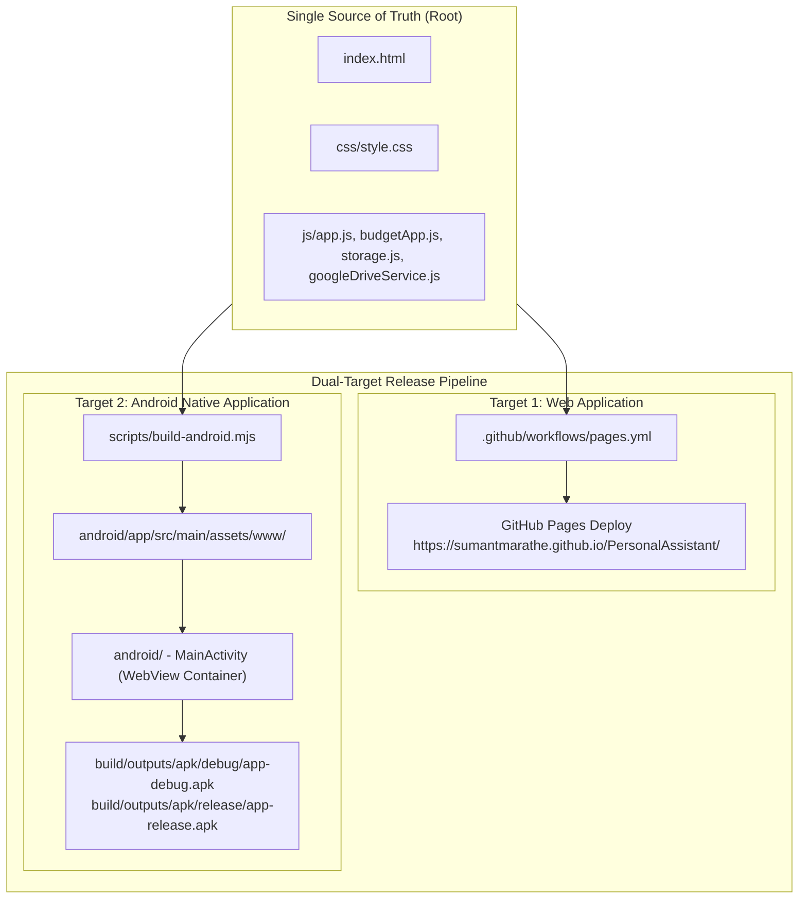

# System Architecture Specification (SPEC-003): Android Application Container & Dual-Target Release Pipeline

**Document ID**: SPEC-003-android-app  
**Sprint**: Sprint 03  
**Status**: 🟢 Certified & Baselined  
**Author**: System Architect  
**Reviewer**: Tech Lead  

---

## 1. Architectural Strategy & Topology

The Personal Assistant suite adopts a **Unified Codebase, Dual-Target Architecture**:



---

## 2. Standalone Android Container Design (`android/`)

### 2.1 Package & Identity
- **Application ID / Namespace**: `com.personalassistant.app`
- **Application Label**: `Personal Assistant`
- **Min SDK**: 26 (Android 8.0 Oreo)
- **Target SDK**: 36 (Android 15)
- **Compile SDK**: 36

### 2.2 Native WebView Host Configuration
`MainActivity` initializes a full-screen, hardware-accelerated `WebView` configured with:
```kotlin
webSettings.apply {
    javaScriptEnabled = true
    domStorageEnabled = true           // Enables LocalStorage & IndexedDB
    databaseEnabled = true             // Enables HTML5 Web SQL / DB
    allowFileAccess = true             // Allows loading bundled local assets
    allowContentAccess = true
    allowFileAccessFromFileURLs = true
    allowUniversalAccessFromFileURLs = true
    cacheMode = WebSettings.LOAD_DEFAULT
    useWideViewPort = true
    loadWithOverviewMode = true
}
```

### 2.3 Asset Bundling & Instant Offline Launch
- `scripts/build-android.mjs` copies the root web application files into `android/app/src/main/assets/www/`.
- On launch, `MainActivity` loads `file:///android_asset/www/index.html`.
- **Result**: Instant launch with 0ms network latency and 100% offline functionality.

### 2.4 Native Hardware Back-Button Integration
- The Android system back-press is intercepted via `OnBackPressedCallback`:
  - If a modal or internal navigation history is active, the web view navigates back (`webView.goBack()`).
  - Otherwise, it delegates to default Android activity finish behavior.

---

## 3. Storage & Cloud Sync Parity

1. **Local Persistence**:
   - `PersonalAssistantDB` operates via standard browser IndexedDB inside the Android WebView.
   - Data persists across app process termination and device reboots in `/data/data/com.personalassistant.app/app_webview/IndexedDB/`.
2. **Cloud Sync**:
   - When connected to the internet, `GoogleDriveService` communicates directly with Google Drive API (`drive.file` scope).
   - In-memory OAuth token lifecycle is preserved.

---

## 4. Deterministic Error Diagnosis & Failure Modes
Adhering to QMS NCR-2026-003, all Android network state transitions (airplane mode, offline, connection drops) are handled gracefully:
- Offline edits are saved immediately to local IndexedDB.
- Cloud sync attempts while offline notify user with clear status `"Offline - Changes saved locally"` without false error diagnostics.

---

## 5. Gate 1 Pre-Flight External Dependency & Credentials Verification
- [x] Android SDK Platform 36 verified.
- [x] Android SDK Build-Tools 36.0.0 verified.
- [x] JDK 23 with `JAVA_HOME` configuration verified.
- [x] Gradle wrapper 9.1.0 verified.
- [x] Android Virtual Device `medium_phone` verified.
- [x] Google OAuth Client ID `346635727868-js7g17t1nklilet2c28b4i54o5is2eil.apps.googleusercontent.com` verified.
- **Gate 1 Status**: **PASSED** &rarr; Ready for Lead Developer (`TASK-019`).
