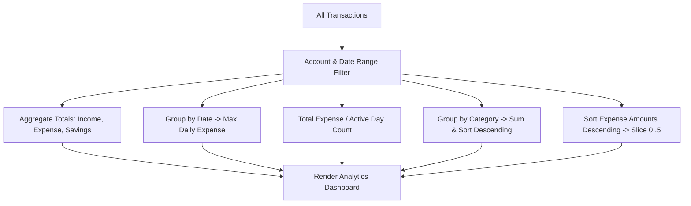

# [SPEC-006] Analytics Engine, Multi-Account Schema & Mobile UX Architecture

> **Category**: `Architecture Specification` | **Sprint**: `Sprint 06` | **Target**: `v1.7.0`  
> **Status**: 🟢 `Approved & Baseline Certified`  
> **Author**: `System Architect` | **Reviewer**: `Tech Lead`  
> **Traceability**: [REQ-006](../requirements/REQ-006-analytics-accounts-mobile.md) • [RTM.md](../v-cycle/RTM.md)

---

## 1. Data Schema Extensions

```typescript
interface Account {
  id: string;          // e.g. "acc_axis_001"
  name: string;        // e.g. "Axis Bank"
  accountNumber?: string; // Last 4 digits or full mask
  ifsc?: string;       // e.g. "UTIB0000123"
  color?: string;      // Visual badge color
  isDefault?: boolean;
}

interface Transaction {
  id: string;
  type: 'income' | 'expense';
  amount: number;
  category: string;
  description: string;
  date: string;        // ISO 8601 YYYY-MM-DD
  accountId?: string;  // Associated account reference
  createdAt: string;
}
```

---

## 2. Statistical Analysis Pipeline



---

## 3. Mobile Viewport Layout Strategy

- **Dual-Label Segmented Tabs**:
  - Desktop: Render `.tab-label-full` (`Ledger & Entry`, `Analytics & Stats`, `Accounts (1)`).
  - Mobile ($le 640	ext{px}$): Hide desktop header bar (`.app-nav { display: none !important; }`). Render `.tab-label-short` (`Ledger`, `Stats`, `Accounts`) with `white-space: nowrap` and `flex: 1`.
